<!-- BANNER - terminal rafael.sh --live. Generated by scripts/banner/generate.py.
     Cache-bust with ?v=N after regenerating. -->
<picture>
  <source media="(prefers-color-scheme: dark)"  srcset="assets/banner-dark.svg?v=1">
  <source media="(prefers-color-scheme: light)" srcset="assets/banner-light.svg?v=1">
  
</picture>

 

 

&nbsp;&nbsp;

 

 

<!-- HUD cards - generated by scripts/hud/generate.py, refreshed daily by .github/workflows/hud.yml -->
<picture>
  <source media="(prefers-color-scheme: dark)"  srcset="assets/hud-profile-dark.svg">
  <source media="(prefers-color-scheme: light)" srcset="assets/hud-profile-light.svg">
  
</picture>

### ◢ ARSENAL

  

  

  

 

<picture>
  <source media="(prefers-color-scheme: dark)"  srcset="assets/hud-telemetry-dark.svg">
  <source media="(prefers-color-scheme: light)" srcset="assets/hud-telemetry-light.svg">
  
</picture>

<picture>
  <source media="(prefers-color-scheme: dark)"  srcset="assets/hud-loadout-dark.svg">
  <source media="(prefers-color-scheme: light)" srcset="assets/hud-loadout-light.svg">
  
</picture>

`◢ END OF TRANSMISSION · San Luis Potosí, MX`

